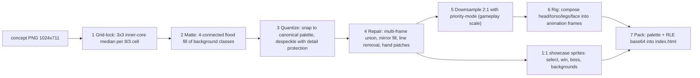
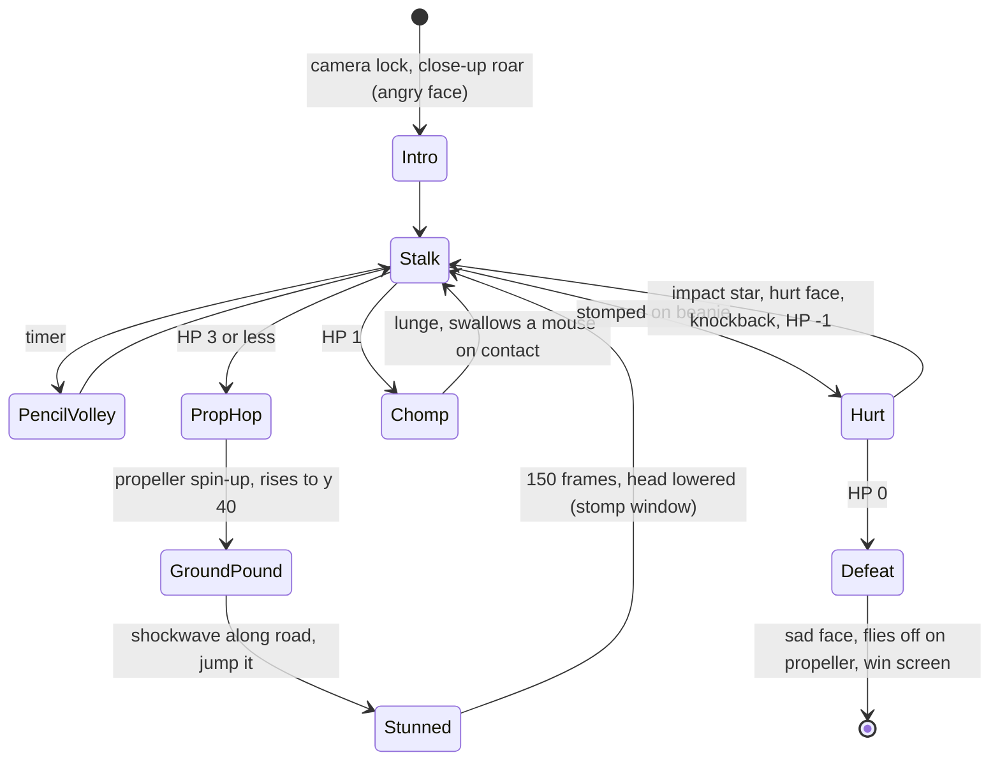

# Mouse Squad: City Scramble — Full Build Plan

A side-scrolling platformer built on the **Ring Chase engine** (`index.html`, one file, 1,901 lines) using the 5 concept frames. You pick one of three mice. The other two follow behind you (this reuses Ring Chase's follow-the-leader trail). You walk and jump through a 2D city street and fight the big red school-supply monster at the end.

````carousel

<!-- slide -->

<!-- slide -->

<!-- slide -->

<!-- slide -->

````

---

## What I measured (research results)

### 1. The concept art is upscaled pixel art at a fixed grid. We can recover the original pixels.
I wrote a PNG analyzer that uses only the Python standard library (PIL isn't installed). It runs an edge-phase coherence search over every sprite region. Every static frame locks to the **same grid**:

| Measure | Value |
|---|---|
| Pixel pitch | **8/3 = 2.6667 screen px per art pixel** (coherence 0.40–0.51 on sprites, versus ≤0.1 for any other pitch) |
| Grid phase | X = **2.00**, Y = **0.66** (screen px) |
| Full frame | 1024×711 screen → **383×266 art px** |
| Playfield (inside the black letterbox) | screen y 68→644 = 576 px → **exactly 384×216 art px (16:9)** |

**Native game resolution = 384×216.** It matches the concept 1:1 and fits 16:9 TVs.

Proof of concept: I resampled the select-screen frame onto this grid. The mouse came back clean, at its true resolution:


### 2. Which frames are clean and which are not
- **On-grid, so we can extract 1:1 with pixel accuracy:** select screen (all 3 mice, HUD), win screen (3 cheering mice, bus, bus stop, building, road, confetti), boss close-ups (fur, face, propeller, pencils, ruler, claws), and all backgrounds (sky, clouds, trees, hedge, road, HUD).
- **Off-grid (smoothed in motion, coherence ≈0.1):** the walking mice in the fight frame and the airborne mice in the angry frame. They're used only as **pose references** for re-tracing at gameplay scale. Pixels are never copied from them directly.
- **Compression noise:** about 7,500 unique colours per sprite, but they collapse to 6–12 real colours (noise is ±1–6 per channel). That means palette snapping is required.

### 3. Measured palette (canonical hex, noise removed)
| Element | Colours |
|---|---|
| Sky / cloud | `#69EDFC` / `#FCFCFC` |
| Hedge | `#03B733` body, `#03CF39` highlight |
| Tree canopy / trunk / apples | `#03CF39`, `#03B733` / `#8D5733` / `#FC3939` |
| Road | `#456369` base, `#3F575D` dark band, `#6F9FA5` dashes |
| HUD green / black | `#3FFC03` (frame, text, pills) / `#030303` |
| Trophy gold / grey | `#F3FC39` / `#757575` |
| Boss HP meter | `#FCFCFC` empty, `#FC6903`→`#FCA503` filled, `#210309` outline |
| Party icons | `#FC03A5` magenta, `#03F9FC` cyan, `#F9FC39` yellow |
| Close button | `#E133CF`, `#9F15BD`, white |
| Boss | fur `#CF2D5D`, fur shade/claws base `#B11B45`, deep `#931539`, mouth `#210309`, eye `#FCF393`, claws `#E1D587`, teeth `#FCFCFC`, propeller `#335DCF`/`#8DBDCF`/`#F3F3F3`, pencil `#F3AB27`/`#FCEDC3`, ruler `#9F6FE7` |
| Cyan mouse (center) | dark `#696969`, light `#E1E1DB`, ear `#EDB7B1`, black |
| Magenta mouse (glasses) | dark `#878787`, light `#EDEDED`, ear `#FCB7B1`, white, glasses purple (to sample), bow pink |
| Yellow mouse (headband) | dark `#575751`/`#45453F`, light `#E1DBD5`, ear `#FCBDC3`, headband magenta/teal (to sample) |
| City (win frame) | brick `#D58775`/`#DB6363`, window `#F3DBC3`, bus `#FCE739`, bus-stop blue `#338DE7` |

---

## User Review Required

> [!IMPORTANT]
> **Boss scale.** The boss only appears unoccluded and on-grid in the **close-up** frames (about 189 px wide). Gameplay mice are about 57 px tall. I plan to use the boss **1:1 at close-up scale**, because any non-integer rescale destroys pixel accuracy. That makes the boss larger relative to the mice than in the fight frame. The arena will therefore have **tree-canopy platforms** on both sides so you can reach the propeller-beanie weak spot.

> [!IMPORTANT]
> **Art the concept doesn't contain has to be authored in the concept's style.** That includes walk-cycle in-betweens, the boss's legs and closed mouth, a few facial expressions, minor enemies, cheese pickups and the far city skyline. Method: build them from extracted parts (same palette, same pixel grid), then hand-correct them in a built-in pixel editor. No AI image generation goes into the final pixels, because it can't match the exact grid and palette.

> [!WARNING]
> **Ring Chase stays untouched.** The new game lives in a new folder inside the workspace (`mouse-squad/`) and copies the engine. It isn't edited in place.

## Open Questions

> [!IMPORTANT]
> 1. **Names:** game title, the three mice (I'm using `pink` = glasses/bow, `cyan` = center boy, `yellow` = headband) and the boss (placeholder: "Big Red").
> 2. **Mouse differences:** cosmetic only, or small stat differences? Proposed: pink jumps highest, cyan runs fastest, yellow gets a double jump.
> 3. **Lives:** proposed **"party = lives"**. When the leader is hit, that mouse is knocked out (its icon in the bottom panel goes dark) and the next follower takes the lead. Losing all 3 means restarting from the checkpoint. OK?
> 4. **Scope:** one full level ("Main Street", about 12 screens) plus the boss, with the architecture ready for more. The concept says "LEVEL 02". Do you want more levels now?
> 5. **Tooling:** OK to create a local Python venv with Pillow and numpy? Installing needs network access. If not, I'll use the stdlib pipeline I already wrote; it works, it's just slower.

---

## Proposed Changes

### Folder layout

```
mouse-squad/
  index.html              ← the game (engine + generated ASSETS blob, single file like Ring Chase)
  concept/                ← the 5 frames, renamed: select.png fight.png boss_angry.png boss_sad.png win.png
  tools/
    png.py                ← stdlib PNG read/write (prototype already working)
    gridlock.py           ← Stage 1
    matte.py              ← Stage 2
    quantize.py           ← Stage 3
    repair.py             ← Stage 4
    downsample.py         ← Stage 5
    rig.py                ← Stage 6
    pack.py               ← Stage 7 → writes ASSETS into index.html between /*ASSETS_BEGIN*/ /*ASSETS_END*/
    build.py              ← runs 1→7 and writes art/contact_sheet.png + art/fidelity.txt
    recipes/*.json        ← per-sprite instructions (frame, box, matte keys, palette, repairs)
    editor.html           ← tiny palette-locked pixel editor (load PNG, paint, save) for touch-ups
  art/native/*.png        ← grid-locked frames (383×266)
  art/parts/*.png         ← rig parts (heads, torsos, legs, faces)
  art/sprites/*.png       ← final sprites = source of truth (editable)
  art/patches/*.png       ← hand-painted fixes, layered on top by repair.py
```

---

### Sprite pipeline (exact methods)



**Stage 1: Grid-lock** (`gridlock.py`)
- Cell (i,j) spans screen x ∈ [2.00 + i·8/3, 2.00 + (i+1)·8/3), y ∈ [0.66 + j·8/3, …).
- Sample a 3×3 lattice at offsets +0.75, +1.35, +1.95 px inside each cell. That's the inner core, which avoids resampling seams. Take the **per-channel median** of the 9 samples.
- Record `spread = max channel range` per cell. A cell with spread > 40 is a seam cell and is resolved in Stage 3 by neighbour majority.
- Re-run the phase detector on each frame and save the result in the recipe. If a frame drifts more than 0.15 px, use that frame's own phase.
- Output: `art/native/<frame>.png` at 383×266. The playfield is rows 25–240.

**Stage 2: Matte / background removal** (`matte.py`)
- Each recipe lists **background classes** as colour ± tolerance:
  - Select screen: black ≤`#141414`, grid-line greys `#1E1E1E`–`#3C3C3C`, disc colours `#03F9FC`/`#FC03A5`/`#F9FC39` ±24.
  - Sky frames: `#69EDFC` ±22, cloud `#FCFCFC` (only when connected to sky), and the hedge/road/tree palette.
- **4-connected flood fill from the box border** through background classes. This keeps interior blacks (eyes, mouth, glasses gaps) because face colours enclose them. It also never leaks through the 1-px diagonal tails, because a 4-connected fill can't cross an 8-connected line.
- Output: RGBA with alpha 0/255 only.

**Stage 3: Palette quantization** (`quantize.py`)
1. Median-cut to K colours inside the mask (K = 10 for mice, 16 for the boss, 8 for background tiles).
2. Snap each cluster to the nearest **canonical colour** from the table above if ΔE(CIELAB) < 8. Otherwise keep it as a new canonical colour and flag it in `fidelity.txt` for review.
3. Map every pixel to the nearest palette entry in Lab.
4. Despeckle: a pixel whose 8 neighbours all differ from it takes the neighbour majority. Exception: **protected detail colours** (outline black, tail grey, eye highlight white, glasses purple) are never removed.

**Stage 4: Occlusion repair** (`repair.py`, driven by the recipe `repairs` list). Methods, applied in this order:
1. **Multi-frame union:** align two frames of the same art by cross-correlating the fur mask (±6 px search). For each pixel, take it from whichever frame has it unoccluded. Occluders are masked by the mouse palette, HUD green and meter colours.
2. **Mirror fill:** for near-symmetric art (boss body, propeller, tree canopies), fill remaining holes from the mirrored pixel about a measured axis. Asymmetric items (pencils, ruler) are re-applied afterwards.
3. **Line removal:** HUD frame line pixels (`#3FFC03`, 2 px thick) crossing a sprite are replaced by vertical interpolation from the rows above and below.
4. **Hand patches:** `art/patches/<sprite>.png` (alpha-masked) is layered on last. These are painted in `editor.html` with the sprite's palette locked.

**Stage 5: Gameplay-scale downsample** (`downsample.py`). Exactly 2:1, so it stays integer and lossless in structure.
- Each 2×2 block becomes one pixel, chosen by a **priority-weighted mode**. Weights: outline/eye black ×3, accessory colours (bow, glasses, headband, ear pink) ×2, light fur ×1, dark fur ×1. Ties go to the top-left pixel.
- **Feature rescue:** pupils at least 2×2 black, mouth line kept at 1 px, glasses rim continuous (fixed by an 8-connectivity check), one-pixel outline closed around the silhouette.
- Result: select-screen mice at 99–118 px tall become **50–59 px**, the same scale as the fight frame.

**Stage 6: Rigging into animation frames** (`rig.py`, done offline; the engine just plays frame lists)
- **Parts per mouse**, cut from the 2:1 sprite and the off-grid pose traces:
  - `head`: ears, hair tuft / bow / headband.
  - `face` overlays: about 22×14 px patches.
  - `torso`: white belly oval plus grey sides.
  - `armL`, `armR`.
  - `legF`, `legB`: traced from the fight frame by box-filtering the crop onto the native grid and quantizing to that mouse's established palette.
- **Frame recipes** list part, offset and flip (example: walk2 = legF at (+2,0), legB at (−2,−1), torso bob −1). `rig.py` composites them, closes the outline and writes `art/sprites/<mouse>_<anim><n>.png`. I review each frame on the contact sheet and patch it if needed.
- **Tail is not baked into gameplay frames.** It's drawn at runtime as a 1-px pixel-snapped quadratic curve in the mouse's dark fur colour, about 30 px long. It sways with velocity (`sin(t)·4 + −vx·3`), matching the concept's long thin tails. The 1:1 showcase sprites keep their original baked tails.

**Stage 7: Packing** (`pack.py`)
- New asset format `{w,h,pal:[[r,g,b]…], rle:"<base64>"}`. Run-length encoded `(index,count)` byte pairs; index 255 means transparent.
- `decode()` in the engine is extended to read this format. The old `px` arrays still work.
- Each sprite gets a pre-flipped copy for left-facing, cached at load time.
- Estimated total size: about 120 KB of base64, versus Ring Chase's 95 KB inline arrays.

---

### Sprite inventory (source box in concept screen px → method)

**Mice: 1:1 showcase sprites**

| Sprite | Source | Box (x0,y0,x1,y1) | Native size | Repairs |
|---|---|---|---|---|
| `pink_select` | select | 145,280,345,545 | ≈75×99 | disc under feet removed; rebuild foot soles (2–4 px) by patch |
| `cyan_select` | select | 415,225,650,540 | ≈88×118 | disc removal; grid line through tail tip cleared |
| `yellow_select` | select | 650,315,885,545 | ≈88×86 | disc removal |
| `pink_win`, `cyan_win`, `yellow_win` | win | 105,180,350,580 / 355,125,680,520 / 660,215,912,580 | ≈92×150 / 122×148 / 95×137 | matte against the busy scene with a palette mask; confetti pieces on fur removed with a confetti-colour mask plus neighbour fill; the panel edge crosses pink and yellow → line removal |

**Mice: gameplay scale (≈50–59 px tall, anchor at bottom-centre of feet).** For each of the 3 mice:

| Animation | Frames | Rate | How it's made |
|---|---|---|---|
| idle | 2 | 30f | 2:1 select head + neutral torso; frame 2 = body 1 px lower |
| walk | 4 | 8f, faster when running | legs and arms re-traced from the fight-frame poses (all 3 mice are walking there) |
| jump / fall | 1 / 1 | — | angry-frame airborne poses (pink and cyan there; yellow derived from pink's pose) |
| land squash | 1 | 4f | rig: torso −2 px, legs bent |
| hurt | 1 | — | rig + "> <" face |
| cheer | 2 | 10f | rig: arms up, happy face (from the win poses) |
| swallowed / KO icon | — | — | party icon greyed |

**Mouse facial expressions** (face overlay patches, sourced from the concept):
1. **neutral smile** — select screen
2. **determined** — brows down, fight frame (cyan)
3. **happy** — ^ ^ eyes and open mouth, win screen
4. **worried** — wide eyes and flat mouth, angry frame (pink)
5. **hurt** — > < eyes, authored

**Boss "Big Red": 1:1 close-up scale (≈189 px wide)**

| Part | Source | Method |
|---|---|---|
| Body + arms + claws | angry ∪ sad (290,270,790,640) | multi-frame union (mice sit in different places in the two frames) → mirror fill about axis x≈525 screen → remove HUD line at y≈605 → patch |
| Bottom of body + legs/feet | **off-screen in the close-ups** | authored at 1:1 from the fight-frame reference: yellow toe-claws, light-blue/white striped socks (fight frame 520–780 × 560–600) |
| Propeller beanie | sad frame (405,272,645,365), clean | extracted 1:1. Animated at runtime by drawing the blade pair horizontally scaled by \|cos(θ)\| (4-step quantized) for a spin effect |
| Pencils L/R, ruler | angry (340,370,420,400) / (630,380,712,430) / (625,300,718,370) | extracted as separate layers, also reused as **projectiles / enemies** |
| Face: ANGRY | angry frame: one yellow eye, angry brow, fangs, open mouth | overlay patch |
| Face: SAD / defeated | sad frame: closed droopy eyes, worried brows | overlay patch |
| Face: HURT | authored: sad brows + squeezed eye (X), mouth open | patch |
| Face: CHOMP | authored: mouth closed (jagged line, two fangs out) | patch |
| Mouth interior | fight frame (green tongue/uvula `#219F03`) + angry teeth | rebuilt layer under the face |

**World / backgrounds (1:1)**

| Asset | Source | Notes |
|---|---|---|
| Sky | flat `#69EDFC` | — |
| Cloud L / S | fight (188,288,268,334) / (680,200,735,232) | — |
| Tree A (apples) / Tree B | angry (855,215,1024,610) / fight (0,240,110,525) | canopy completed by mirror; trunk extended; HUD line removed |
| Hedge tile | fight row y 518–545 | auto-detect scallop period by autocorrelation → seamless tile (~14×10) |
| Road tile | fight row y 545–644 | auto-detect dash period → seamless tile (~64×39) |
| Bus-stop sign | win (322,408,370,520) | also used as the **checkpoint** |
| School bus | win (108,350,320,510) | half-hidden behind pink → completed from reference (simple geometry: yellow body, black stripes, cyan windows); roof = platform |
| Brick building | win (820,400,912,520) | basis for the shop-front palette |
| Far skyline | **authored procedurally** | seeded RNG of flat rounded buildings in brick/peach colours lerped 45% toward sky (`#69EDFC`), window grids, no outlines (concept backgrounds have none) |

**HUD: replicated exactly at native playfield coordinates (x, y, w, h)**

| Element | Rect | Details |
|---|---|---|
| Frame | (4,4,376,200) | radius 10, `#3FFC03`, 2 px |
| LEVEL panel | (16,15,82,41) | black, r=4 |
| "LEVEL 02" text | — | ~8 px glyphs, `#3FFC03` |
| Trophies | — | 4 sprites, 12×14 each, gold/grey (extracted) |
| PROGRESS label + bar | label (153,21); bar (119,31,146,15) | bar is a green pill holding 16 segments; filled segments go yellow→orange (colours sampled per segment), empty segments white |
| SCORE panel | (284,15,82,41) | "SCORE" ~11 px glyphs |
| Score pill | (292,37,64,14) | 9 white digits |
| Boss HP meter | (299,102,26,73) | 5 segments, filled orange from the bottom; arena only |
| Party panel | (164,193,54,20) | 3 head icons (magenta/cyan/yellow); a dark icon means that mouse is KO |
| Close "X" | letterbox | becomes Pause/Quit (HTML overlay on touch) |

- **Fonts:** the glyphs L E V 0 2 S C O R P G are extracted from the HUD. The missing letters and digits are authored to match: same stroke width, height and corner style. Ring Chase's `F35` 3×5 font is kept for small menu text and extended with the missing glyphs J Q Z and 0–9.

---

### Engine: what gets kept, replaced or added (`index.html` line refs are Ring Chase)

| Lines | System | Action |
|---|---|---|
| 1–93 | HTML/CSS shell, touch pad, A/B, pause | **Keep.** A = jump, B = swap leader. Rethemed to green/black |
| 95 | `ASSETS` inline arrays | **Replace** with the generated blob |
| 97–165 | maze, layouts, `solidAt` | **Replace** with level data + rectangle collision (`solids[]`, `oneWay[]`, `pits[]`) |
| 167–192 | canvas `fit()` | **Keep, modify:** fixed 384×216, largest integer scale that fits (fractional fallback), pixelated |
| 194–321 | CRT WebGL shader | **Keep.** Change the scanline period to 1 source px (`Vy = uSrc.y`) because 1 art px = 1 source px now |
| 332–351 | `decode()` / `SPR` | **Extend:** RLE format + flipped copies |
| 353–407 | dirt texture | **Delete.** Replaced by background builders (parallax, tiled hedge/road, procedural skyline) |
| 409–601 | `Walker` surface-runner | **Replace** with `Body` AABB platformer physics; keeps the variable-height gravity idea from `jump()`/`step()` |
| 603–623 | trail + `trailFollow()` | **Keep and generalize:** follower k samples the trail at delay `k·DELAY` with gap `k·MIN_GAP` (DELAY 14, MIN_GAP 36 px, matching the concept's spacing) |
| 625–689 | ring + BFS AI | **Delete.** Replaced by enemy + boss AI |
| 691–747 | keyboard, gamepad connect | **Keep** |
| 749–912 | chiptune engine | **Keep the scheduler.** New tracks, plus a **noise channel** (AudioBuffer white noise with envelopes) for drums and SFX |
| 914–1080 | touch, WebHID, `pollPads` | **Keep** unchanged |
| 1083–1194 | states, difficulty, IndexedDB, remap, settings | **Keep.** `DIFFS` redefined (EASY / NORMAL / HARD: enemy speed, boss HP 4/5/6, aggression). IndexedDB stores high score, trophies, best time |
| 1198–1248 | title chase AI | **Replace** with the attract mode: the three mice walk a looping street behind the logo, using the trail |
| 1250–1293 | pixel fonts | **Keep + add** the HUD fonts |
| 1295–1352 | menu flow | **Keep the structure.** The `mode` phase goes away; `char` becomes the 3-way select-screen replica |
| 1371–1384 | `reset()` | **Replace** with `loadLevel()` / `respawnAtCheckpoint()` |
| 1491–1518 | `drawWalker` | **Replace** with `drawActor` (anim state → frame, flip, runtime tail) |
| 1520–1588 | fixed-step loop, `padEdges` | **Keep** |
| 1589–1629 | `tick()` | **Rewrite** for the new systems |
| 1634–1887 | `render()` | **Rewrite.** Keeps the pause overlay; the win-burst star code is reused for the boss-defeat explosion |

**Game states:** `title → menu → settings/remap → select → intro → play ⇄ paused → bossIntro → boss → bossDefeat → win`, plus `gameover → play` (back to checkpoint).

---

### Gameplay spec

**Physics** (native px, 60 Hz). Ring Chase's values are scaled down by about 0.72 for the smaller world.

| Constant | Value |
|---|---|
| Max run speed | 1.9 |
| Acceleration | 0.12 |
| Release friction | ×0.80 per frame |
| Skid (reversing) | 0.30 |
| Jump velocity | 4.2 |
| Gravity while rising with jump held | 0.13 (apex ≈ 68 px, about 1.2 mice high) |
| Gravity otherwise | 0.30 (tap apex ≈ 29 px) |
| Terminal fall speed | 4.5 |
| Air control | 0.10 |
| Coyote time / jump buffer | 6 frames each |
| Mouse hitbox | 22×44 |
| Stomp | bounce at 3.2 |
| Hit | 90 frames of invulnerability |

- Ground (feet line) is at **y = 188**; the road fills 177–216.
- **Camera:** horizontal only. It looks 40 px ahead of the leader, lerps at 0.12, snaps to whole pixels, is clamped to the level and locks in the arena.
- **Parallax layers** (scroll factor): sky 0, clouds 0.08 (+ drift), far skyline 0.25, near buildings 0.6, trees/props/hedge/road 1.0. The HUD draws on top.

**Level 1, "Main Street"** (4,608 px = 12 screens). Built from props: solids, one-way platforms and pits.

| X range | Section | Contents |
|---|---|---|
| 0–768 | Park Gate | trees, hedge, bus stop (spawn); cheese arc; low crate. Tutorial: walk, jump, follow |
| 768–1536 | Bus Stop | parked school bus (roof one-way at y 132); 2 eraser walkers; **Trophy 1** on a tree canopy |
| 1536–2304 | Shops | brick shopfronts with awnings (one-way at y 120 / 96); 2 open-manhole pits; 3 pencil hoppers; **Trophy 2** above the awning chain |
| 2304–3072 | Construction | crate stacks; crane plank moving horizontally; paper airplanes flying a sine path; **checkpoint 2** (bus stop) |
| 3072–3840 | School Street | mixed enemies; **Trophy 3** hidden behind the hedge (walk-through gap) |
| 3840–4608 | Schoolyard Arena | camera locks at 4224; Tree A on each side (canopy one-way platforms at y 96 and y 128) |

- **Minor enemies** are built from boss accessory sprites so they stay in palette:
  - *Pencil hopper*: the extracted pencil, hopping.
  - *Eraser walker*: authored, pink and blue.
  - *Paper airplane*: authored, white.
- **Pickups:** cheese wedge (authored in trophy gold), +100.
- **Scoring:** stomp +200, with a chain ×2, ×4… on consecutive stomps; trophy +1000; boss hit +500; boss defeat +5000; time bonus at the end. Every score updates the 9-digit pill.
- **Progress bar:** `floor(16 · leaderX / arenaX)` segments filled.

**Boss AI** (state machine with telegraphs; HP meter = 5 segments):



- **Weak spot:** the propeller beanie (a 40×20 hurtbox). Touching the body or claws hurts you.
- **Impact star:** replicates the concept exactly (10-point star, white 2-px outline, pale pink fill at 55% alpha, expanding over 12 frames). It's drawn with the star routine already in Ring Chase's win-burst code.
- **Swallowed mouse:** shown in the mouth, as in the concept. Hitting the boss before the next Chomp makes it spit the mouse back out. Otherwise that mouse is KO.

**Screens that replicate the concept frames:**
- **Character select:** the select frame at 1:1. Procedural perspective grid (vanishing point and line spacing measured from the frame), LEVEL 00, grey trophies, 000000000. The selected mouse's disc pulses and the mouse bobs.
- **Win:** the win frame at 1:1. Rounded panel holding the street scene; mice overflow the panel edge; confetti particles (6 sampled colours); giant green "WIN" letters behind; green dot = replay, white pill = menu.

**Audio:** 4 original chiptune tracks in Ring Chase's `[start,dur,note]` format (title/select, Main Street loop, boss, win jingle), plus about 10 SFX (jump, stomp, cheese, trophy, hurt, KO, boss roar, propeller whir, ground pound, boss hit).

---

## Build order (milestones)

1. **Tooling + grid-lock + matte + quantize** for all 5 frames → `art/native/*`, first contact sheet.
2. **1:1 assets:** select mice, win mice, boss union/repair, props, backgrounds, HUD glyphs.
3. **Gameplay mice:** 2:1 downsample → parts → rig → 3 mice × 11 frames + 5 faces → review and patch.
4. **Engine port:** fixed 384×216 canvas, `Body` physics, camera, parallax, level loader, trail followers.
5. **HUD + select screen + title/menu/settings.**
6. **Level 1 content:** props, enemies, pickups, checkpoints, pits, scoring.
7. **Boss fight:** all states, faces, projectiles, star FX, meter, defeat.
8. **Win / game-over screens, audio, save data.**
9. **Polish + verification.**

## Verification Plan

### Automated
- `python3 tools/build.py`: rebuilds every asset and writes:
  - `art/contact_sheet.png`: each sprite at 4× next to its concept crop.
  - `art/fidelity.txt`: for every 1:1 sprite, the % of unoccluded pixels matching the concept's grid-locked pixel (target **≥ 97%**) and the mean ΔE (target **< 3**). Any unmapped colours are listed.
- **Screen fidelity test:** render the in-game select and win screens headless in Chrome (DevTools MCP screenshot at 384×216) and diff them against `art/native/select.png` / `win.png`. Target ≥ 95% pixel match outside animated regions.
- **Engine checks:** `node --check` on the extracted script; a physics smoke test running a scripted input sequence (spawn → jump onto the bus roof → reach the arena) through `tick()` without rendering.

### Manual
- Play through on keyboard, gamepad and touch (portrait phone with the pad, landscape TV), with CRT on and off.
- Boss: every state reachable on EASY / NORMAL / HARD; swallow and spit-out works; defeat leads to the win screen.
- You review the contact sheet and the screen diffs before the polish phase.
